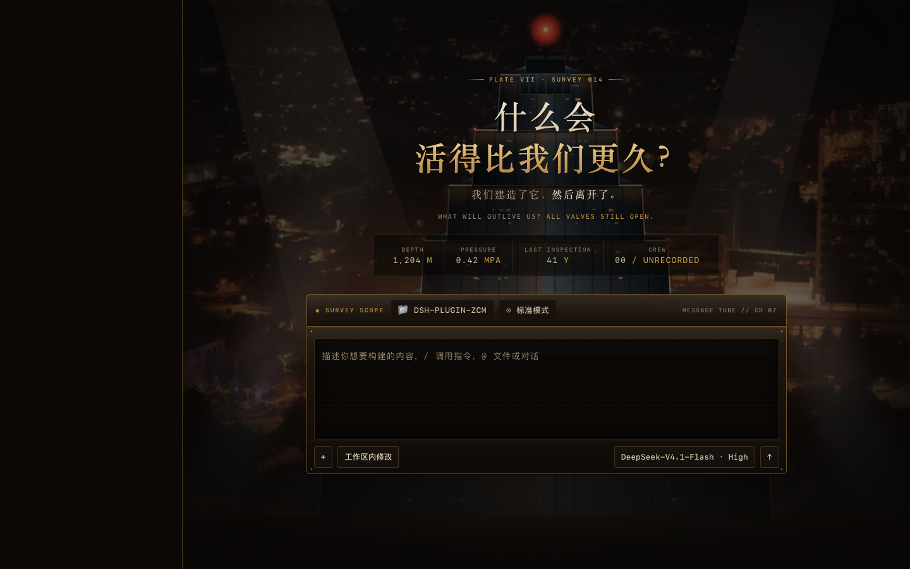
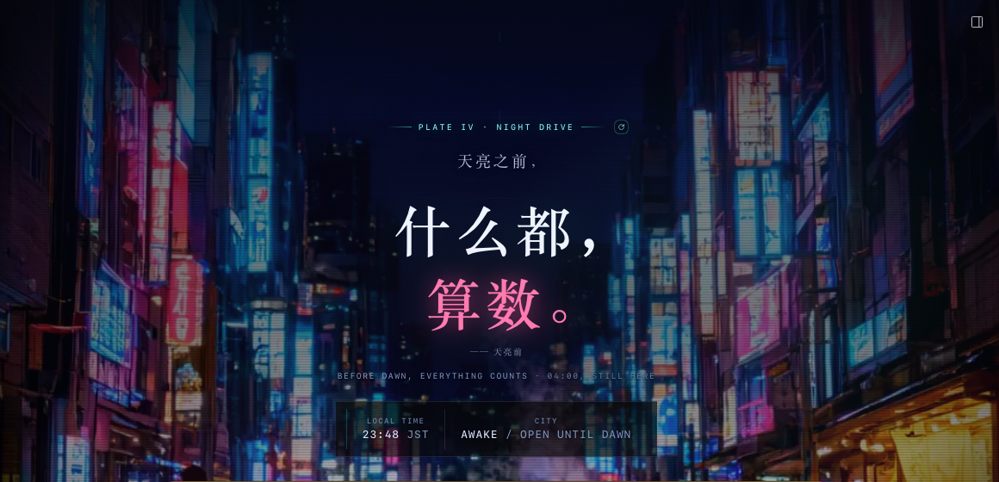
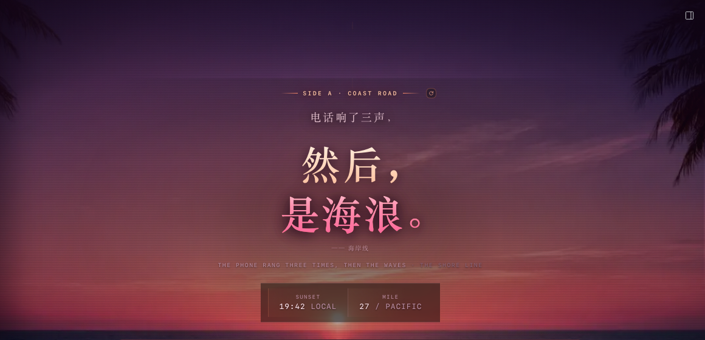
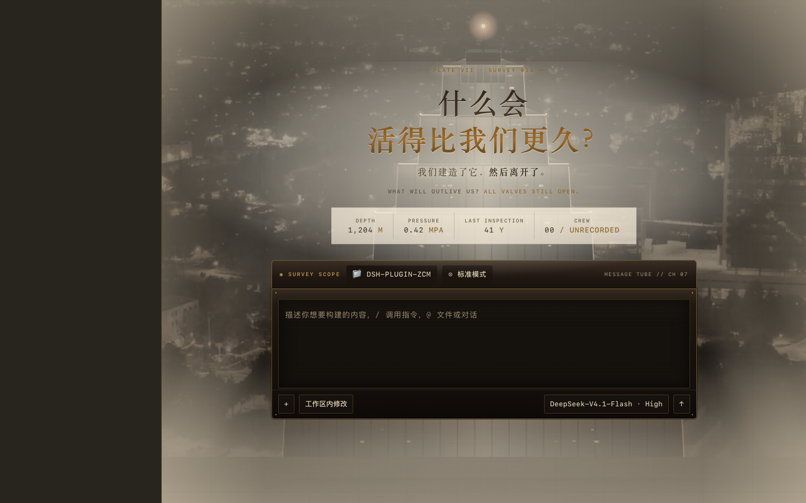

# SECTOR 07 · 七号扇区

**简体中文** · [English](README.en.md)

> 三套 DSH Web GUI 夜间皮肤：**以太工造**、**霓虹夜行**、**落日海岸**。  
> Three night-shift skins for the DeepSeek Harness web GUI.

一个包，三套皮肤，共用同一套界面解剖。切换只换材质和字牌：不改布局，不重载页面，不需要第二个插件。

| 皮肤 | id | 一句话 | 主色 | 首屏 |
| --- | --- | --- | --- | --- |
| **以太工造**<br>AETHERWORKS | `aetherworks` | 一座未完工的蒸汽巨构，仍在替不在的人运转 | 骨白 / 黄铜 / 烟熏黑 | [](preview/live-dark.png) |
| **霓虹夜行**<br>NEON DRIFT | `neon` | 雨里的招牌、等车的出租车，和一间还开着的拉面摊 | 青 / 品红 / 深蓝 | [](preview/neon-hero.png) |
| **落日海岸**<br>SUNSET COAST | `sunset` | 一条没有尽头的海岸公路，六点钟的太阳，粉色的过去 | 珊瑚 / 铬 / 紫罗兰 | [](preview/sunset-hero.png) |

以太工造的完整亮色界面：

[](preview/live-light.png)

## 为什么叫 SECTOR 07

`SECTOR 07` 是前两套皮肤里已经存在的坐标：以太工造的侧栏写着 `SURVEY // SECTOR 07`，霓虹夜行的街道是 `NIGHT LINE // SECTOR 07`。落日海岸的 `MILE 27` 是同一条夜行路线上的海岸段。三套皮肤因此不是三个互不相干的主题，而是同一个夜班区域里的三个地点：巨构、街道、海岸。

包名：`@zcm/dsh-client-ui-skin-sector-07`。仓库名只保留坐标，不再把个人缩写放进项目名。

## 安装

要求：DSH Web **0.2.1-rc.2** 或兼容版本；当前只在 Web GUI 验证。

> **一个 profile 只保留一套 skin bundle。** 本包内部已经带三套皮肤；如果再同时启用 `maid-atelier` 等其他 skin 插件，两套皮肤会叠加、互相覆盖。安装前先移除旧的 skin：

```bash
dsh plugin --profile web remove @smalltailqwq/dsh-client-ui-skin-maid-atelier
```

从 GitHub `main` 安装：

```bash
dsh plugin --profile web add 'github:Evan1987/dsh-sector-07#main'
```

装好后**重启一次 DSH**。之后切换皮肤即时生效，不用再重启。

本地开发安装：

```bash
git clone https://github.com/Evan1987/dsh-sector-07.git
cd dsh-sector-07
pnpm install
pnpm build
dsh plugin --profile web add "$PWD"
```

卸载：

```bash
dsh plugin --profile web remove '@zcm/dsh-client-ui-skin-sector-07'
```

## 切换

侧栏底部有皮肤切换器，点当前皮肤名展开三选一。也可以直接用键盘：

| 快捷键 | 皮肤 |
| --- | --- |
| `Alt+1` | 以太工造 |
| `Alt+2` | 霓虹夜行 |
| `Alt+3` | 落日海岸 |

选择写入 `localStorage` 的 `sector-07:skin`，刷新后保留。切换只就地重绘场景、字牌和 favicon，当前页面的题词、会话和输入内容都不动。调试时也可以直接加 `?skin=neon` 或 `?skin=sunset`。

着陆页的题词牌右侧有一个换句圆钮；裸键 `R` 也可以换一句。输入框内按 `R` 不会触发，带 `⌘/Ctrl/Alt` 也不触发。

## 三套皮肤

### 以太工造 · AETHERWORKS

复古未来主义 / 蒸汽朋克 / 巨构。铆接钢板、黄铜仪表、外露桁架、停在 `03:17` 的钟，以及一张夜间巨构底片。暗色是雨夜中央尖塔，亮色是测绘纸档案副本。

- 独有：亮色模式；着陆页巨构场景；`PLATE VII · SURVEY 014`。
- 设计文档：[docs/aetherworks.md](docs/aetherworks.md)（世界观、视觉系统、界面映射、插件实现、验收清单）。

### 霓虹夜行 · NEON DRIFT

雨夜街道，青色结构打底，品红只标记“正在发生的事”。湿沥青、便利店、还开着的拉面摊。暗色专用。

- 独有：霓虹灯牌与湿路反光；`PLATE IV · NIGHT DRIVE`；`23:48 JST`。
- 用户消息从纸片变成背光玻璃，墨色同步换成浅色（`--aw-note-*`），不会出现黑字黑底。

### 落日海岸 · SUNSET COAST

19:42 的海岸公路：珊瑚色太阳、铬色反光、没有尽头的路。暗色专用。

- 独有：海岸落日底片；`SIDE A · COAST ROAD`；`MILE 27 / PACIFIC`。
- 同样使用玻璃质感的用户消息底板，暖色墨。

三套皮肤共用同一个题词池（22 条，逐条标注出处），切换皮肤时保留当前这句。题词池与引用边界见 [Aetherworks 文档 §5.3](docs/aetherworks.md#53-着陆页)。

## 开发

```bash
pnpm install
pnpm typecheck
pnpm test        # 先构建，再跑 22 个 jsdom 契约测试
pnpm build       # 产出 lib/index.js + lib/client.js
```

- `src/client/index.ts`：作用域、样式注入、chrome 节点、切换器、清理。
- `src/client/skins.ts`：三套皮肤的名称、字牌、色板、favicon。
- `src/client/theme.css`：共用界面解剖；`src/client/skins/*.css`：各皮肤材质。
- `build/build.mjs`：esbuild 产出 host ESM 与浏览器 closure factory；CSS/HTML/WebP 全内联。
- `lib/` 是提交进仓库的构建产物，GitHub 安装不需要在用户机器上再构建。
- `tests/apply.test.mjs`：manifest 一致性、挂载/卸载、明暗、remount、题词、皮肤切换、bundle 形态。

CI 在 Node 22 + pnpm 11 下跑 `typecheck` 和 `test`，并检查构建后的 `lib/` 与提交内容无差异。

## 兼容与边界

- **client-only**：host 半边是 no-op；不注入服务、不发 Cordis 事件、不读取/修改模型请求。
- **无远程资源**：CSS、HTML、WebP、SVG 全部内联进 `lib/client.js`，运行时不发图片/字体请求。
- **可逆**：卸载时移除自己的 style、scene、hero、favicon、theme-color、title 改动，还原 body 属性。
- **互斥**：`skin.json` 的 `wiring.id = ui-skin-sector-07`；同一 profile 不要再启用别的 skin bundle。
- **无跟踪**：不收集使用数据，不访问网络。

## 许可

代码 MIT。文字、配色、UI 结构、SVG 光效与 HUD 叠层为原创；引用的 22 条台词/哲学名句逐条标注出处，仅为文字，不含剧照、角色形象或字体文件。城市照片来自 Pexels（[photo 34945401](https://www.pexels.com/photo/34945401/)，Pexels License）。完整边界见 [docs/aetherworks.md §12](docs/aetherworks.md#12-许可与边界)。