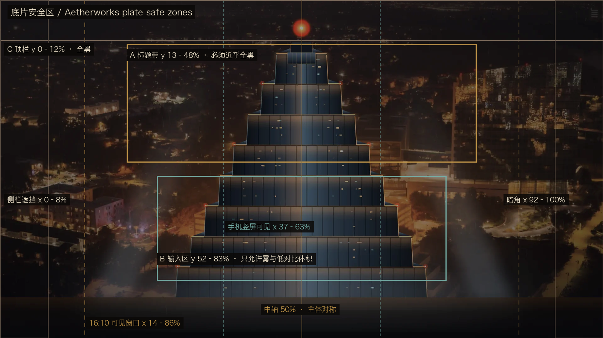

# 底片生图需求 · Aetherworks Background Plate

> 历史设计记录（2026-10-26 更新）：夜间阶梯巨构底片 `hall.webp` 已移除，当前明暗模式均使用 `dusk.webp` 列车图。下文夜间巨构的极暗阈值和替换步骤仅作历史参考，不再作为当前皮肤的验收要求。

> 给 Codex / 生图模型 / 外包画师的完整规格。目标不是"一张好看的科幻图"，而是**一张能当 UI 背景用、且验得过关的夜间底片**。
> 这份文档里的每个数字都对应 `tools/check-plate.py` 里的一条断言，能跑通即合格。

---

## 0. 一句话目标

**一座仍在运转、但已经没有人的夜间巨构，航拍，极暗，正中对称，暖光只剩零星的几扇窗和一颗信标。**

它不是主视觉（hero 图），是底片（plate）：画面 85% 以上接近黑，文字和面板压在上面。凡是"漂亮"和"可读"冲突的地方，一律让位给可读。

---

## 1. 它会被怎么用（先看这个，再看画面）

| 事实 | 后果 |
|---|---|
| 底片是 1920×1080（16:9），`background-size: cover` | 会被裁，不会完整显示 |
| 场景层左侧让位给侧栏（默认 290px），只铺内容列 | 在 1440×900 视口下，**只显示中间约 72% 宽**（x 14–86%） |
| 手机 390×844 | 只显示中间约 **26%** 宽（x 37–63%） |
| hero 标题居中、HUD 十字线居中、巨构中轴也居中 | 主体**必须落在正中竖轴上**，左右对称 |
| 输入框是半透明面板，压在画面下半部 | 那一带只允许雾和低对比体积，不允许窗格阵列 |
| 顶栏是沉浸式透明条 | y 0–12% 必须几乎全黑 |

**结论：主体必须收在中央窄条里也能成立。** 任何"左重右轻"的大对角线构图在这里都是浪费——左边会被侧栏吃掉。



> 图为现状底片叠安全区示意（为看清结构提亮过）。A 标题带 / B 输入区 / C 顶栏 / 两侧暗角，就是必须压暗的四块地。

---

## 2. 画面主体

**必须有：**

- 一座**阶梯式（ziggurat）工业巨构**：层层收分，桁架、铆接钢板、锅炉、烟囱、外露管道、检修平台、悬挑的缆索与吊臂。
- 尺度感：它必须**压过一座城市**，但城市本身不可辨认——只是底部的雾和几粒极小的灯。
- 顶部一颗**红色航空信标**，很小（画面占比 < 0.3%），是唯一的纯红点。
- 零星**暖黄窗光**：数量少（十几到几十处），每处很小（几像素），亮度低，不成片。
- 湿气、雾、雨后的空气感；底部被雾吞掉，看不到地平线。
- 少量**探照灯柱**可以留，但必须是"光柱边缘几乎看不见"的感觉，不能是明亮的扇形。

**禁止有：**

- 落日、日出、黄金时刻、被照亮的云、晚霞、月亮（尤其是巨大月亮）。
- 整面亮起来的城市灯海、霓虹、广告牌、青色/蓝色灯带、雨后蓝调。
- 前景大物（列车车体、人物、栏杆、屋顶）压在标题带或输入区上。
- 人物、人脸、角色剪影（远处极小的检修人影也不要——会被读成"有人在"）。
- 文字、编号、水印、边框、UI 元素、HUD、取景框、胶片齿孔。
- 对称之外的强引导线（大桥、公路、铁轨的透视消失点）——它们会把视线带偏中轴。

---

## 3. 构图

- **正中轴对称**，巨构中轴与画幅中心重合（允许 ±2% 偏差）。
- 主体高度占画面 **62–75%**；尖顶落在 y ≈ 14–20%；底部没入雾中，到画面最下沿。
- 主体最大宽度 ≤ 画面 **42%**（给两侧留黑）。
- 视点：**高空航拍**，俯角 15–30°，或与巨构上部平视；不要仰视（仰视会让底座变宽、失去对称感）。
- 画面四角与两边必须有自然暗角，过渡要软，不能有硬边遮罩感。
- **中轴左右两侧可以是"几乎空的暗部"**——这是特性，不是缺点。

---

## 4. 光线与调色（这是最关键的部分）

整体是**极低调（low-key）单色暖褐**，不是"夜色 + 霓虹"。

| 项 | 目标 |
|---|---|
| 全幅平均亮度 | ≤ 0.030（相对亮度；现状 0.014） |
| 全幅 p99 亮度 | ≤ 0.12（只有信标和几扇窗能超过） |
| L>0.35 的亮部面积 | ≤ 0.15%（**没有大面积光源**） |
| 标题带平均亮度 | ≤ 0.022（近乎全黑） |
| 输入区平均亮度 | ≤ 0.035 |
| 顶栏条（y 0–12%） | ≤ 0.012 |
| 左右边条（各 8%） | ≤ 0.012 |
| 平均饱和度 | ≤ 0.30（低饱和，暖褐为主） |
| p90 饱和度 | ≤ 0.52 |
| **青色高饱和可见面积** | ≤ 1.5%（青色光量占比 ≤ 3%） |
| **暖色高光面积** | ≤ 1.2%（暖光只能是点，不能是片） |
| 细节能量（标题带） | ≤ 3.4（低对比，只有轮廓） |
| 细节能量（输入区） | ≤ 3.8 |

配色：**sepia + 黄铜**。阴影是中性的深褐黑（不是蓝黑、不是紫黑），高光是低饱和的琥珀到奶油色。允许极轻微的色差与 halation 让暖点发毛，但不允许光晕泛蓝。

打光逻辑（写 prompt 时按这个描述）：主光几乎不存在，只有一束**极弱的冷月光从上方**把轮廓从雾里剥出来；其余的暖点全是**自发光的小面积光源**（窗、检修灯、信标）。画面 85% 以上是"结构性暗部"，靠边缘和雾的体积读出形体，不靠照亮。

---

## 5. 交付规格

- 分辨率：**1920×1080**（16:9，横），留一份 2560×1440 原件用于重裁。**不要 2:3 / 1:1 / 4:3。**
- 格式：PNG 或高质量 JPEG（≥ 90）。不要先压成低质量再放大。
- 无文字、无水印、无边框、无 UI；边缘自然延伸到画外，不要羽化白边。
- 不要烧进图里的暗角滤镜硬边；暗角要像镜头渐晕。
- 最终入库形态：WebP，q72 左右，目标 **≤ 120KB**（现状 `hall.webp` 71KB）。体积不是硬指标，但主题是单文件零请求，底片会内联成 data URI，别超过 150KB。

---

## 6. Prompt（可直接粘贴）

```
A cinematic night photograph of a colossal unfinished industrial megastructure —
a stepped ziggurat of riveted steel plates, iron lattice trusses, boiler drums,
chimney stacks, exposed pipe runs and narrow maintenance catwalks — standing
alone above a fog-drowned, unreadable city. High aerial view, camera looking
down at 20–30 degrees.

The structure sits dead center on the vertical axis and is perfectly
symmetrical in silhouette. It fills about 70% of the frame height: the spire
tops out at roughly 16% from the top edge, the base disappears into fog at the
bottom edge. Its width stays inside the middle 40% of the frame, leaving near
empty darkness on both sides.

The sky is deep, near-black charcoal — no clouds lit from behind, no sunset, no
sunrise, no moon, no stars. There is essentially no ambient light: more than
85% of the frame is crushed into near-black. A single tiny red aviation beacon
glows at the apex. Fifteen to thirty small warm amber windows are scattered
sparsely across the facade, each only a few pixels wide, none of them merging
into a lit band. Two or three faint searchlight beams rise from the terraces,
their falloff almost invisible against the haze.

A very weak cold moonlight from high above barely separates the silhouette
edges from the fog. Heavy atmospheric haze swallows the lower third and the
city below, so the ground reads as an unreadable dark mass with a few distant
pin pricks of light. Wet air, filmic haze, no visible horizon.

Grade: restrained sepia and brass monochrome, deep neutral brown-black shadows,
low-saturation amber-to-cream highlights, no blue cast, no teal, no cyan, no
magenta. Fine 35mm film grain, soft lens vignetting, subtle halation around the
warm lights only.

Shot on a large format camera, 50mm lens, f/8, long exposure, low-key lighting,
photorealistic industrial realism, museum-quality plate, extremely dark image.
```

**变体参数**（想更冷/更旧时只改这一段，别一次改两处）：

- 更旧、更像档案：`add a faint duotone selenium toning, slightly lifted blacks`
- 让巨构退得更远（画面更空）：`pull the camera back so the structure occupies 55% of frame height`
- 雾更重（可读性更好）：`thicken the fog so the middle terraces dissolve into soft grey-brown mass`

---

## 7. Negative prompt

```
sunset, sunrise, golden hour, orange clouds, lit clouds, bright sky, moon, large
moon, planet, stars, aurora, daylight, blue hour, blue color grading, teal,
cyan, neon, LED strip, electric blue light, magenta, purple, rainbow, lens
flare, light streaks, bloom, HDR glow, oversaturated, high key, bright
foreground, crowds of city lights, dense window grid, illuminated facade,
billboard, signage, text, letters, numbers, watermark, logo, signature, border,
frame, white edge, vignette hard edge, HUD, UI, sci-fi interface, people,
person, face, crowd, train, vehicle, bridge leading lines, perspective vanishing
point off center, tilt shift, fisheye, blurry, low resolution, jpeg artifacts,
cartoon, illustration, concept art sketch, matte painting, plastic look
```

---

## 8. 验收（生成完先跑这个，不要靠肉眼）

```bash
python3 tools/check-plate.py path/to/new-plate.png
```

20 项断言，全 PASS 才算可用。参考基准：

| | 现状 `hall.webp` | 上一版提案（不合格） | 要求 |
|---|---|---|---|
| 全幅平均亮度 | 0.014 | 0.066 | ≤ 0.030 |
| 标题带平均亮度 | 0.014 | 0.122 | ≤ 0.022 |
| 标题带细节能量 | 2.10 | **18.0** | ≤ 3.4 |
| 输入区细节能量 | 2.89 | 16.3 | ≤ 3.8 |
| 顶栏条亮度 | 0.006 | 0.072 | ≤ 0.012 |
| 平均饱和度 | 0.292 | 0.440 | ≤ 0.30 |
| 青色可见面积 | 0.008% | **13.3%** | ≤ 1.5% |
| 暖高光面积 | 0.106% | 5.44% | ≤ 1.2% |
| 铜字对比 p50 | 6.34:1 | 2.38:1 | ≥ 6.0:1 |
| 铜字对比 p90 | 4.99:1 | **1.34:1** | ≥ 4.5:1 |

> 上一版提案 20 项里 18 项不达标。它作为插画是好的，作为底片不成立——差距主要在"标题带亮度 9 倍、细节 8.6 倍、青色 1600 倍"。

跑完还要看两张**合成截图**：把新底片换进 `mock-current-dark.html` 的同款页面，1440×900 截一张，确认标题、副题、四格 stats 都能读；再切亮色模式（`saturate(.28) sepia(.52)`）截一张，确认它变成"旧档案印刷"而不是"褪色的彩色照片"。

---

## 9. 迭代手册（哪项挂了改哪）

| 失败项 | 改法（按代价排序） |
|---|---|
| 标题带平均亮度 / p90 超 | 主体下移或缩小；窗光数量和亮度砍半；把尖顶从 y14% 挪到 y20% |
| 标题带细节能量超 | 减少窗格阵列的密度；让标题带那一段立面落进雾里（最有效） |
| 输入区细节能量超 | 加厚雾；去掉下部平台的栏杆/管道细节 |
| 顶栏条超 | 让天空纯黑，或把主体再往下压 |
| 边条超 | 加强自然暗角（镜头渐晕，不是硬遮罩） |
| 饱和度超 | 降 chroma，往 sepia 走；别再让模型"加氛围光" |
| 青色面积超 | 明确删掉所有蓝/青光源和蓝调天空；检查阴影是否为中性褐黑 |
| 暖高光面积超 | 窗光改成"点"不是"片"；删掉探照灯的可见光锥 |
| 铜字对比不足 | 上面几项合起来的必然结果；回到平均亮度 |

**一次只改一个变量**，否则你不知道是哪句起作用。

---

## 10. 变体 B：夜班出发站（想换叙事时用）

如果这次想连叙事一起换掉（现状是"废弃但仍运转的巨构"，变体是"最后一班车走了"），画面改成：

- 同一夜、同一调色、同一亮度纪律：**凌晨的站台**，一列停着的钢铁列车（侧面剪影，不亮灯带），头顶棚架、吊灯、雨后的湿地反光。
- **不要落日**。原来那版的魅力全在落日，而落日与 `03:17 STOPPED` 的文案直接冲突——放弃它。
- 构图必须改成正中：列车沿中轴纵向延伸（透视消失点在中心），或列车横穿画面但只在 y 55–85% 的输入区以下。
- 青色灯带、月面、未来城市塔群**全部去掉**；只保留铆接钢、暖窗、湿地面。
- 验收标准同上，一个字都不用改。

> 如果走变体 B，文案、`03:17`、配色板要一起改，否则会出现"界面说凌晨三点，底片是黄昏"的硬伤。

---

## 11. 交付清单

1. `new-plate.png`（1920×1080，无损）
2. `tools/check-plate.py` 全 PASS 的输出粘贴回来
3. 两张合成截图（暗色 / 亮色，1440×900）
4. 压好的 `hall.webp`（≤ 120KB）

四项齐了再换 `src/client/assets/hall.webp`，然后重新生成 `preview/live-dark.png` 与 `preview/live-light.png`。

---

## 12. 变体 C：DUSK LINE（已实现，暗色主题的唯一底片）

用户提供的一张现成底片（`傍晚列车.png`，1672×941）被采纳，文件名 `src/client/assets/dusk.webp`（q74，114 KB）。它现在是**暗色主题从首屏到会话的唯一背景**：首屏不再用夜图、进入会话也不再换图。

**它有意违反 §2 与 §4 的三条硬约束**，此处记录为设计例外，而非放宽验收阈值：

| §  | 约束 | 这张图 |
|----|------|--------|
| 2  | 禁止月亮（尤其巨大月亮） | 画面正中一轮巨月 |
| 2  | 禁止前景列车占据画面 | 左下角列车切边占据 |
| 4  | 禁止蓝/紫调；只允许钠灯橙 + 鼠尾草绿 | 整片钴蓝天空 + 品红云带 |

`tools/check-plate.py` 的 20 项断言**没有改动**，它继续管辖 `hall.webp`（夜间底片）。dusk 底片按设计豁免，不是因为阈值被调低——所以拿这张图跑 check-plate 会 FAIL 19/20，这是预期行为，不是 bug。

**实现方式：一张底片，两个相位。** `[data-ds-dark-theme] .aw-plate-dusk` 直接以 `opacity: 1` 挂载，hero 与 active 共用同一张图，只做镜头位移和曝光变化：

- hero：`background-position: 58% 34%`，月亮落在标题后方；`.aw-hero-copy::before` 的 scrim 加深到 `rgba(7,6,5,.66)`。
- active：同一张图平移到 `44% 46%`，用 `filter: brightness(.60) contrast(1.06) saturate(.62)` 整体压暗（900ms 过渡）；`.aw-read` 磨砂板已删除。
- 此外，active 还有 `[data-phase='active']::before` 的柔和径向 scrim（中心 .38，82% 淡出）+ 上下 .30/.40 的线性 veil；两态共用 `.aw-scene-host::after` 的自然暗角。没有硬边，也没有 `backdrop-filter`。

**生效范围**：暗色主题的 hero 与 active。浅色主题完全不挂载 dusk，继续用 `hall.webp` + §4 的骨白纸面 scrim（`rgba(222,210,185,.40/.48/.66)`）。

**对比度（1440×900，正文列 x480–1240 / y110–800 的照度分位）**：ink 9.7:1 @p99（最坏像素 8.6:1）、dim 5.6:1 @p99（最坏 4.9:1），正文与次级标签均达 AA；mute 3.9:1、faint 3.2:1 @p99（p90 分别为 4.8 / 4.0），只用于装饰性角标，不单独承载状态。

**叙事冲突仍在文案层**：底片是黄昏出发，而 `03:17 STOPPED` / `LAST INSPECTION 41Y` 仍是凌晨停运的口径。视觉上不再有两个世界，但文案与底片的时间差需要另一次决定：要么改 §6 的 prompt / 底片时间，要么改 `03:17`（它来自 DSH shell 的预览文案，不在本插件 `src` 内）。
